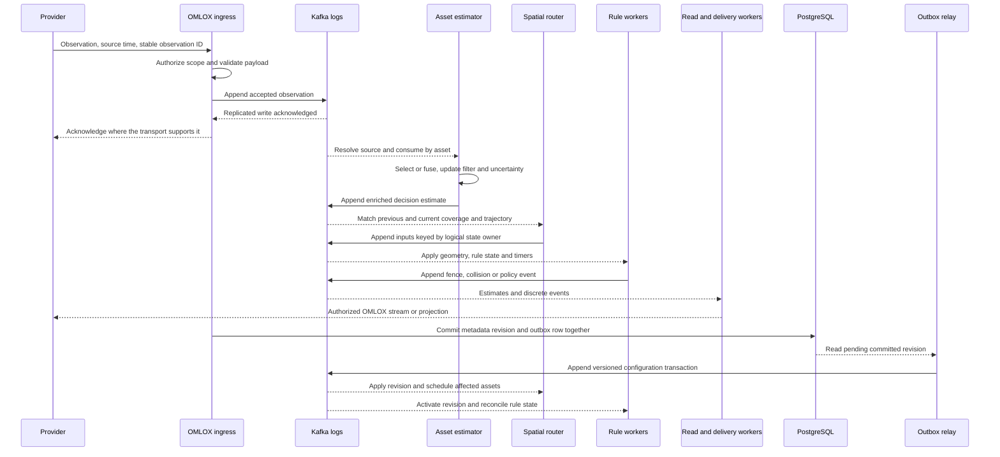

# Open Location Hub 2.0 plan

Design draft dated 26 November 2026. Scope covers the processing architecture, compatibility, migration and proposed Kubernetes deployment. The shell examples describe the deployment interface to build.

## Recommendation

Keep the existing OMLOX REST, WebSocket and MQTT interfaces as the public facade. Move decision-critical processing onto a regional Apache Kafka log. Estimate motion in asset order, route estimates by spatial coverage, then repartition work by the identity of the state machine that owns each decision. Keep geofences, locating rules, policies and resource ownership in PostgreSQL. Propagate changes through a transactional outbox, with a revision on every derived decision.

Use Kafka for delivery and short-term replay, with six hours of retention by default and an independent override for each log. A later downstream consumer can persist selected streams to S3-compatible storage.

Ship fixed spatial routing and recoverable processing first. Adaptive routing, conservative evaluation skipping and federation each have their own rollout criteria. Use a dedicated Hub deployment per tenant until shared hosting passes an end-to-end isolation gate.

Replace SigNoz with Perses, backed by Prometheus and Alertmanager. Provision performance dashboards from Git alongside the first Kafka workers, so each stage can be measured during shadow processing and cutover.

This plan builds on [Design Scalable Asset Tracking](https://chatgpt.com/c/6b06959f-b7a8-83eb-aaf5-6dffe4b9f453), the repository's [current architecture](../docs/architecture.md), [OMLOX compatibility notes](../docs/omlox-0.2-integration-compatibility.md) and [federation plan](federation-plan.md). The public REST contract is [the current OpenAPI document](../specifications/openapi/omlox-hub.v0.yaml). OMLOX wire paths such as `/v2` already exist and keep their current meaning.

## Baseline and reuse

- Keep Go, generated REST bindings, OIDC/static/hybrid verification, MQTT and WebSocket adapters, RPC, PROJ transforms, R-tree and geometry primitives, fence and collision timer semantics, and OpenTelemetry. Keep the existing replay connector and UWB simulator for comparison.
- Preserve the current distinction between native provider observations and selected trackable motion. The current selection lock already serializes work for a trackable within one process. Its provider/source queues, process-local filter and membership state, and bounded drop paths cannot give multiple replicas a shared durable decision history. [Trackable selection](../internal/hub/location_selection.go), [derived processor](../internal/hub/derived_processor.go)
- Replace the decision queues and in-memory event bus as the authoritative path for discrete events. An in-memory bus can still distribute frames inside a gateway. The current metadata snapshot is hub-wide, and collision processing scans active motions and builds an index on the work path. Both merit profiling before setting throughput targets. [Metadata cache](../internal/hub/metadata_cache.go), [collision evaluation](../internal/hub/collision_events.go)
- Preserve behavior covered by the current companion specs, especially provider and trackable memberships, floor/elevation compatibility, timer precedence and exits without an additional observation. Treat changes to crossing, collision prediction or transport acknowledgements as explicit policy or contract changes. [Fence semantics](../specifications/omlox/fences.md), [WebSocket protocol](../specifications/omlox/websocket.md), [MQTT protocol](../specifications/omlox/mqtt.md)

## Processing architecture



### Data and partition ownership

Each row describes a logical stream or processing boundary. Start with a small fixed set of topics per regional deployment, and combine compatible streams only where they share retention and ordering needs.

| Stream or stage | Partition or ownership key | Role |
| --- | --- | --- |
| Accepted observations | Tenant, origin hub, provider, source | Durable ingress record for location and proximity, with source sequence when available |
| Resolved asset inputs and enriched estimates | Tenant, origin hub, trackable | One writer for selection, fusion, estimation, motion version and previous estimate |
| Spatial routing | Tenant, coordinate space, spatial cell | Versioned interest index and incremental index of nearby active objects |
| Fence membership | Tenant, fence, subject kind and ID | Independent provider and trackable entry, exit, dwell and timer state |
| Occupancy or other collective policy | Tenant, fence or policy | Consume membership transitions, optionally shard intermediate counts with an explicit aggregation frontier |
| Collision state | Tenant, canonical unordered asset pair | Resolve duplicate candidates from neighboring cells, own transition state and deadlines |
| Resource changes | Tenant or single-tenant hub scope | Ordered committed transaction bundles and revisioned snapshots |
| Read and delivery streams | Asset, audience or subscription group as required | Latest-state projection, cursor-based discrete delivery, authorized and rate-limited motion fan-out |

Start with fixed cells and a topology version. Use a bounded metric grid in local indoor coordinate spaces and test a hierarchical grid for WGS84. Include site, coordinate frame and applicable floor or elevation semantics before matching. Keep logical asset, membership and pair keys stable as cells move. Pick partition counts from measured load. Use versioned topic generations or a stable virtual-shard mapping with an explicit migration barrier when scaling would remap keys. Kafka ordering applies within a partition. A configuration revision and an estimate arriving on different partitions have no implied relative order. [Apache Kafka design](https://kafka.apache.org/43/design/design/)

Use a versioned binary internal envelope, initially Protobuf with compatibility checks in CI. Include event and causation IDs, tenant and origin hub, provider/source and trackable identities where applicable, source/ingest/processing times, source and asset sequences, schema and rule/configuration revisions, and coordinate-frame metadata. Add a topology version on spatially routed records. Store the routing context as it was at production time. Keep offsets and physical partition numbers in operational metadata. Derive output IDs from the input or timer identity, logical state key, transition kind and processing revision. Distinguish an intentional correction from a retry. Keep the current public UUID shape through a stable mapping where necessary.

### Ingest, estimation and publication

1. Derive tenant scope from authenticated principals. Validate the entire batch and its resource references before durable writes. Preserve the existing batch contract. If it requires atomic acceptance across partitions, use one bounded Kafka transaction and committed reads. Require stable idempotency identifiers from integrations that need safe retries. For legacy observations without an upstream ID or sequence, document the limits of hash-based deduplication, particularly for legitimate repeated samples.
2. Return acceptance after Kafka confirms the configured durability policy. Use idempotent producers, replication factor three and minimum in-sync replicas two for the production baseline. Return retriable overload or dependency errors before acknowledgement, with defined request timeouts and per-tenant quotas. Treat ambiguous append outcomes as retryable with the original IDs. For MQTT, distinguish provider PUBACK from Hub durability. Use persistent broker subscriptions, suitable QoS and subscriber acknowledgement after append where supported. Define what QoS 0 and the existing WebSocket protocol can guarantee. Specify any extra delivery acknowledgement with the protocol contract.
3. Resolve source bindings, zones, transforms and proximity hysteresis using versioned metadata. Establish the trackable identity before the asset-keyed stage. Preserve current provider and locating-rule selection first. Add sensor fusion as an opt-in policy with explicit handling of source changes, incompatible frames, and missing accuracy. Carry native observations separately for integrations that require them.
4. Estimate in a metric frame with `float64`, time-dependent position and velocity state, and explicit covariance. Define reset, gap, stationary and outlier behavior. Emit current and previous position, speed in m/s, heading convention and validity, acceleration where defensible, uncertainty, source provenance and freshness. Publish enriched trackable motion through the facade and keep native provider streams compatible. Validate drift, units and coordinate conversions using deterministic reference trajectories and sensor feeds.
5. Keep a decision stream at the cadence required by the strictest enabled rule. Apply subscriber-specific throttles, heartbeats and motion coalescing after decision inputs are available. Decouple latest-state persistence and gateway delivery from fence and collision work. Expose timestamps or staleness for eventual read models. Where an existing endpoint requires immediate read-after-write, document how its projection catches up or what contract change would be needed.

Define event-time policy by source class. Allow a bounded reorder buffer and publish its effect on latency. Hold future timestamps and excessive clock skew to validation limits. Very late samples remain available for audit or controlled correction and cannot silently rewind live state. Record output versions, reject stale projection writes, and preserve explicit expiry and deletion semantics. When spatial repartitioning changes arrival order, the asset owner assigns the sequence and the router carries it forward. Ordered per-shard inputs, bounded reorder or a reconciliation protocol must prove that gaps and late arrivals cannot silently skip transitions.

For the first implementation, keep fence candidate assembly and dispatch asset-keyed. Use a bounded, in-memory interest index for the assigned coordinate spaces. Each router can look up all intersected cells for that asset's estimate in sequence, deduplicate candidates and emit one geometry input per logical membership. Route collision broad phase independently through cell owners. If distributing fence cell ownership becomes necessary, prototype a bounded per-asset merge using an explicit expected-cell set and versioned replies. An incomplete merge must stall or flag and reconcile that asset's decision stream. It cannot stand in for a complete set of candidates.

### Geofences, collision and persistent interests

- Register geofence geometry, filters and revision as a persistent spatial interest. Index its bounding coverage in every intersected cell. Use the current and previous footprint, active memberships and uncertainty-expanded swept path to select candidates. Active membership can be supplied through a recoverable reverse index or by an asset-owned routing ledger. Test jump exits, missing intermediate samples and old-floor cleanup. Evaluate exact geometry in the membership worker. Model crossings inferred from a segment as a defined policy with uncertainty and gap limits. Preserve current point-based OMLOX semantics as the compatibility default.
- Partition logical membership by fence and asset or provider. Send entry, exit and dwell changes to collective state instead of sending every observation to a fence-wide consumer. For wide or overlapping fences, use coarser hierarchical coverage and measure fan-out. If precise occupancy must be queried under load, specify when the merged count is complete, how it reconciles and what a late transition changes.
- Update collision indexes incrementally. Replicate boundary candidates into a halo sized for the maximum supported radius, speed, freshness and prediction horizon. Deduplicate by ordered asset pair and sample versions, reconsider active pairs when assets leave candidate range, and expire stale tracks. Define deterministic timestamp alignment and coordinate compatibility. Keep current contact events compatible and introduce predictive risk separately. Benchmark dense and adversarial cases. If the system exhausts its eligibility or latency budget, declare degraded status and suppress stale actionable output according to policy.
- Persist timer deadlines and generation tokens with state. On recovery, process overdue timers in deterministic order, preserving their effective times and preventing the same transition from firing twice. Preserve OMLOX administrative deletion behavior while updating projections. Put any reclassification or correction events behind an explicit extension contract.
- Consider conservative safe regions only after equivalence testing. A skip expires on a relevant rule or geometry revision, uncertain movement, loss of freshness or the next timer. Prototype adaptive spatial split/merge only after showing that fixed cells hit a measured limit. A versioned routing change must warm target indexes, duplicate or buffer inputs during handoff, deduplicate by stable identity, drain through an offset barrier and retain the old mapping until lagging consumers finish. Test rollback, boundary motion and crashes during handoff. [SPEAR](https://pmc.ncbi.nlm.nih.gov/articles/PMC9097911/), [BBoxDB Streams](https://doi.org/10.1007/s10619-022-07408-8)

### Transactional configuration and activation

- Store geofences, rules, provider mappings, transforms, authorization policy references and history in PostgreSQL. Write a tenant-ordered revision and its outbox record in the same transaction. Ensure revision order reflects commit order. A per-tenant revision row is an acceptable control-plane serialization point in the first release. Use a Go outbox relay with one active publisher per scope, retries, observability and durable IDs. Evaluate Debezium when change volume or external writers justify CDC. Restrict writes to the transactional path or give external writers the same outbox contract.
- Publish a transaction bundle with old and new spatial coverage, changed policy and resource versions, tombstones and dependent resources. Cap bundle size or stage referenced snapshots and publish a final manifest. Publish before marking the outbox row sent. Treat a crash between those operations as a duplicate. Consumers apply the entire transaction atomically in their cache and reject revision regressions. Use a dedicated revision reader per cache replica or distribute changes to owned shards explicitly. A shared load-balancing consumer group alone will leave other caches stale.
- Bootstrap from a consistent PostgreSQL snapshot with an associated revision, then catch up on recorded transactions with gap detection. Use bounded region caches and avoid PostgreSQL lookups per sample. Pin a versioned snapshot during a decision. An API configuration write is visible after commit. Worker activation and completion of reconciliation are separate measured states. A stale or unavailable revision can use a bounded last-known-good policy, with decision behaviour after the freshness limit explicitly configured. Authorization and revocation enforcement has its own boundary and must fail closed.
- For each changed interest, enqueue a versioned reevaluation over old and new coverage plus existing members. Reconcile stationary assets, policy changes, deletes and timer invalidation. Each affected shard records an input/projection frontier, snapshots at that frontier, then catches up through buffered live inputs. Conditional state updates keep the backfill from overwriting newer observations. Expose revisions used in outputs and an activation status for each affected shard. The first release offers atomic application within a worker and bounded convergence across workers. A requirement for simultaneous cross-shard activation or strictly ordered effects across config and data streams needs a sequenced activation protocol.

### Recovery, storage and delivery

| Component | Plan |
| --- | --- |
| PostgreSQL | Authoritative metadata, revision history, outbox, access scope, hub identity, and coalesced/versioned read projections when latency permits. Use the existing pgx/sqlc and Goose path. Test index and connection budgets on shared databases. Keep basic PostgreSQL usable without PostGIS. Evaluate PostGIS separately for bounded query workloads, with a compatible extension build and DBA approval. |
| Kafka | Default replicated regional append log with replay, consumer groups, per-key ordering and transactions within Kafka. Default each Hub topic to six hours of retention and allow per-topic overrides. Provision topics and ACLs declaratively. Keep automatic topic creation disabled. Use managed Kafka where available, or Strimzi/KRaft on Kubernetes. [Kafka design](https://kafka.apache.org/43/design/design/), [Strimzi deployment guide](https://strimzi.io/docs/operators/latest/deploying) |
| Worker state | Restore full filter, membership, timer, sequence and pair state from durable versioned snapshots plus retained changelogs. Store current snapshots with input and changelog offsets independently of Kafka event expiry, so idle keys and long-running timers survive the replay window. Qualify a snapshot store based on throughput and recovery time. Benchmark Go workers and Kafka transactions for atomic output, changelog and offset commits, with committed reads, fenced ownership and bounded commit batches. Local caches are disposable. Validate restore time and state growth against a Flink prototype for one stateful stage. [Flink architecture](https://flink.apache.org/what-is-flink/flink-architecture/) |
| Downstream writes | Use versioned upserts, unique event IDs or a transactional inbox for PostgreSQL and side effects. Persist results before advancing offsets, or couple consumed offsets to state and outputs in a Kafka transaction where supported. Downstream delivery is at least once when a replay cursor exists. Clients deduplicate discrete events. Existing live streams have their documented delivery semantics. |
| Replay and optional persistence | Keep the configuration revisions, topology decisions, timer inputs and rule/estimator versions needed to replay the retained data. Record original revision assignments or the inputs that determine them when exact replay is required. Replay into an isolated generation with external effects disabled. Longer event history can be added later via an independent S3-compatible sink or another downstream consumer, with its own retention and access policy. |
| Smaller deployments | Evaluate NATS JetStream only if footprint justifies a second profile. Qualify keyed sequencing, replay, ownership transfer and output/offset recovery against the same behavior tests. A narrow PostgreSQL outbox is appropriate for metadata distribution, and would require a separate load and recovery test before being considered for observations. [NATS JetStream](https://docs.nats.io/concepts/jetstream) |

Apply the six-hour default to all Hub-owned event topics, including observations, intermediate estimates and evaluation inputs, configuration changes, state change events, discrete outputs and quarantined inputs. Put a common default and per-topic overrides in deployment values. Use Kafka's time-based delete policy (`retention.ms=21600000` by default), with segment rolls sized for the configured window. Measure retention from broker append time and keep the source event time in the envelope. Kafka expires segments, so the setting is a replay budget with segment-level cleanup. A topic size cap can shorten the available window. Compacted checkpoint topics hold current worker state by key and use worker state lifecycles for expiry. Validate actual topic settings for both managed and self-hosted Kafka. [Kafka topic configuration](https://kafka.apache.org/43/configuration/topic-configs/)

Back up PostgreSQL with tested point-in-time recovery. Record backup and recovery cutoffs, snapshot offsets and Hub identity. Keep periodic checkpoints recent enough for restore and catch-up within the shortest relevant topic window. Compare saved offsets with the earliest retained offsets before restoring a worker or resuming a client. If an offset has expired, surface a gap and reconcile from current state or request a fresh snapshot. Transitions whose inputs have expired may be unrecoverable. Alert on remaining replay headroom using consumer lag age and topic retention. Apply backpressure when sustained ingest keeps consumers from catching up. Keep quarantine bounded by the same default.

A future object-storage sink would consume selected events independently, with checkpointed writes, deduplication, expiry and access controls. If the sink falls behind the available Kafka window, record the resulting gap. Its availability is independent of the Hub's ingest acknowledgement and decision processing.

## Kubernetes deployment

Package application and stateful infrastructure as independent Helm releases or GitOps units. Use one Go image with explicitly configured roles initially. Run separate Deployments for the facade, outbox relay, estimation/routing and rule workers, projectors and gateways as scale requires. Use a single-replica relay or fenced active owner. Keep long-lived database and broker resources outside the application release. Deploy bounded topic partitions and tune worker scaling on lag age, processing rate and partition count. Include readiness for initialization and dependency access, liveness for process health, graceful drain and timeouts on termination, disruption budgets and zone spread. Keep gateway and worker rollouts compatible across one release interval.

Use a TLS ingress or Gateway for HTTPS/WSS, a private MQTT listener where needed, a private Kafka listener and PostgreSQL TLS with hostname verification. Keep stable Hub identity in durable configuration. Use service accounts per role, restricted pods, deny-by-default network rules, broker ACLs and an external secret manager or sealed/encrypted secrets. Keep the runtime DB user separate from the migration role. Run migrations once per release using a serialized Goose Job and an advisory lock. Use additive schema changes across rolling upgrades. Verify writable primary, target database and expected owner, permissions, runtime connectivity and version policy before running migrations. Verify Kafka topic/ACL bootstrap, lag and reconnect behavior before exposing traffic. Use isolated test tenants or topics for smoke tests.

### PostgreSQL selection and upgrades

- **Existing PostgreSQL.** An explicit stack binding identifies the DB, endpoint and namespace-local Secrets with role-specific DSNs and CA material. The DB may be an existing Kubernetes Service or a managed external instance. Require a dedicated Hub database, or explicitly qualified schema isolation. Reuse the selected database if it is an upstream-supported, Hub-qualified major on a current patch, with measured capacity and an agreed backup owner. Report incompatibility and stop for remediation. A DNS, TLS or authentication error must never trigger a new database.
- **No PostgreSQL.** Provision a dedicated CloudNativePG cluster using the current stable PostgreSQL release and a compatible stable operator. Use three instances spread across failure domains, appropriate persistent volumes and a documented replication policy. Configure WAL archiving and off-cluster backups with a supported backup plugin. The infrastructure release provisions role bindings and Secrets for the app and migration Job. A single instance is a separate dev profile.
- **Latest version policy.** PostgreSQL **19.0** is the current stable release as of 26 November 2026. CloudNativePG's stable 1.30 line lists support through PostgreSQL 18. The 1.31 release candidate adds PostgreSQL 19 support. Require a qualified stable operator with PostgreSQL 19 support before approving a new production in-cluster database on that release. A managed provider that already supports PostgreSQL 19 can use the existing-database path. Qualify the PostgreSQL 19 path in a disposable cluster while stable operator support is pending. [PostgreSQL version policy](https://www.postgresql.org/support/versioning/), [CloudNativePG support matrix](https://cloudnative-pg.io/docs/devel/supported_releases/), [CloudNativePG releases](https://cloudnative-pg.io/releases/)
- **Version maintenance.** Release CI resolves the latest stable upstream major and patch, verifies the chosen image and operator pairing, signs or verifies the image provenance, and produces a tested image reference by digest. A dependency update opens a reviewed change for each patch, with a scheduled freshness check so the lock does not age quietly. Keep the deployment inputs versioned and reproducible. PostgreSQL major upgrades require a rehearsed maintenance plan, backups and a rollback or reverse migration strategy. Existing clusters use their DBA's upgrade path. [PostgreSQL upgrades](https://www.postgresql.org/docs/current/upgrading.html), [CloudNativePG operand images](https://github.com/cloudnative-pg/postgres-containers)

### Example scripts for both stack types

These examples call proposed Helm charts. The platform team installs the supported operators and CRDs, creates the namespace and provisions access to Secrets, storage, backup targets, ingress and the OIDC issuer. Each install pins its Kubernetes context. The stateful charts are independent of the app chart and apply their own storage, backup and network policies. Serialize each deployment in CI or GitOps.

The common deployment script accepts an explicit stack inventory. `DB_MODE=external` means the stack provides PostgreSQL. `DB_MODE=managed` means the Hub owns a new cluster on initial install and reuses that same cluster on reruns. Record the selected mode and a stable database binding ID at first successful bootstrap. The application chart's pre-install/upgrade preflight checks an existing binding before writes and requires a separate migration procedure to change it. The platform deployer also checks the binding before invoking the managed infrastructure chart. Failed checks stop the rollout. Helm targets and Secret names are supplied as values or release metadata.

```bash
#!/usr/bin/env bash
# Proposed deploy/kubernetes/deploy.sh
set -euo pipefail

: "${KUBE_CONTEXT:?set the target Kubernetes context}"
: "${HUB_NAMESPACE:?set the prepared namespace}"
: "${HUB_VALUES:?set the Hub values file}"
: "${DB_MODE:?set external or managed from the stack inventory}"
: "${DB_BINDING_ID:?set the stable database binding ID}"

helm_ns=(helm --kube-context "$KUBE_CONTEXT" --namespace "$HUB_NAMESPACE")
kube_ns=(kubectl --context "$KUBE_CONTEXT" --namespace "$HUB_NAMESPACE")

binding="$("${kube_ns[@]}" get configmap location-hub-db-binding \
  --ignore-not-found -o jsonpath='{.data.mode}:{.data.id}')"
if [[ -n "$binding" && "$binding" != "$DB_MODE:$DB_BINDING_ID" ]]; then
  printf 'Database binding change requires a database migration.\n' >&2
  exit 1
fi

case "$DB_MODE" in
  external)
    : "${DB_RUNTIME_SECRET:?set the existing database runtime Secret name}"
    : "${DB_MIGRATION_SECRET:?set the existing database migration Secret name}"
    ;;
  managed)
    : "${PG_VALUES:?set CloudNativePG storage, backup and TLS values}"
    : "${PG_IMAGE:?supply the release-qualified PostgreSQL tag and digest}"
    "${helm_ns[@]}" upgrade --install location-postgres ./deploy/charts/hub-postgres \
      -f "$PG_VALUES" --set-string "cluster.imageName=$PG_IMAGE" \
      --wait --wait-for-jobs --timeout 15m
    "${kube_ns[@]}" wait --for=condition=Ready cluster/location-postgres --timeout=15m
    DB_RUNTIME_SECRET=location-postgres-runtime
    DB_MIGRATION_SECRET=location-postgres-migration
    ;;
  *)
    printf 'Unsupported DB_MODE %s\n' "$DB_MODE" >&2
    exit 2
    ;;
esac

"${kube_ns[@]}" get secret "$DB_RUNTIME_SECRET" "$DB_MIGRATION_SECRET" -o name >/dev/null

if [[ -n "${KAFKA_VALUES:-}" ]]; then
  "${helm_ns[@]}" upgrade --install location-kafka ./deploy/charts/hub-kafka \
    -f "$KAFKA_VALUES" --wait --wait-for-jobs --timeout 15m
  "${kube_ns[@]}" wait --for=condition=Ready kafka/location-kafka --timeout=15m
fi

# The Hub chart preflight checks database identity, TLS and Kafka access.
# A blocking migration Job runs before the application rollout.
"${helm_ns[@]}" upgrade --install location-hub ./deploy/charts/hub \
  -f "$HUB_VALUES" \
  --set-string "database.mode=$DB_MODE" \
  --set-string "database.bindingId=$DB_BINDING_ID" \
  --set-string "database.runtimeSecret=$DB_RUNTIME_SECRET" \
  --set-string "database.migrationSecret=$DB_MIGRATION_SECRET" \
  --wait --wait-for-jobs --timeout 15m
"${helm_ns[@]}" test location-hub --timeout 5m
```

With existing PostgreSQL and Kafka, the referenced Secret names and endpoints are already provisioned. `stacks/plant-a/hub.yaml` points to the existing Kafka listeners and credentials.

```bash
#!/usr/bin/env bash
set -euo pipefail
export KUBE_CONTEXT=plant-a HUB_NAMESPACE=location-hub
export HUB_VALUES=stacks/plant-a/hub.yaml
export DB_MODE=external DB_BINDING_ID=plant-a-hub-db
export DB_RUNTIME_SECRET=existing-hub-db-runtime
export DB_MIGRATION_SECRET=existing-hub-db-migration
unset KAFKA_VALUES
exec ./deploy/kubernetes/deploy.sh
```

Without PostgreSQL or Kafka, the stateful charts create both. Set `PG_IMAGE` from the approved release manifest before running the wrapper. The PostgreSQL chart provisions namespace-local connection and CA Secrets for the two Hub roles. The Kafka chart provisions the broker, users and topics, and the Hub preflight confirms that credentials, topics and replication settings are usable.

```bash
#!/usr/bin/env bash
set -euo pipefail
: "${PG_IMAGE:?export the qualified current PostgreSQL image from the release manifest}"
export PG_IMAGE
export KUBE_CONTEXT=plant-b HUB_NAMESPACE=location-hub
export HUB_VALUES=stacks/plant-b/hub.yaml
export DB_MODE=managed DB_BINDING_ID=plant-b-hub-db
export PG_VALUES=stacks/plant-b/postgres.yaml
export KAFKA_VALUES=stacks/plant-b/kafka.yaml
exec ./deploy/kubernetes/deploy.sh
```

Keep in-cluster PostgreSQL and Kafka optional independently. With GitOps, express the same dependency order as sync stages and keep the binding in the stack inventory. Provision stateful resources with retention controls that survive application rollback or uninstall. Retry infrastructure creation and credential issuance idempotently. Run smoke tests against a candidate service and promote its route as a separate release step. A Helm rollback alone cannot undo a schema migration or an emitted event. [Helm upgrade reference](https://helm.sh/docs/helm/helm_upgrade/)

## Observability and Perses dashboards

Follow the FormationMap pattern of Prometheus, Alertmanager and Perses with dashboard definitions in Git. Keep the Hub's OpenTelemetry instrumentation and collector-first export. In the standalone profile, send cumulative OTLP metrics from the Collector to Prometheus over its private OTLP HTTP receiver. Preserve process identity so counters and histograms aggregate correctly across replicas and resets. Use the stack's existing collector and metrics ingestion path when available. Scrape Kafka, PostgreSQL and Kubernetes exporters where the stack provides them. Perses queries Prometheus through its server-side datasource proxy. Prometheus rules and Alertmanager own alert evaluation and delivery. Send traces and structured logs to the deployment's existing backends when configured. [Prometheus OTLP guide](https://prometheus.io/docs/guides/opentelemetry/), [Perses Prometheus datasource](https://perses.dev/docs/plugins/prometheus/)

### Worker metrics contract

Instrument a common boundary around every worker and state-machine handler. Record work type consistently across implementations, so an estimation worker and a geofence worker can be compared across builds, replicas and deployment profiles. Each operation documents its unit. The facade handles requests. Stream workers process observations, estimates, candidates, evaluations, timers or result records. For batched consumption, count items and report batch size and duration as separate series.

| Signal | What to record |
| --- | --- |
| Volume | Items received, handler completions by outcome, retries, duplicates, quarantines and durable outputs. Show completions per second and the handled count in the selected time range. Show state evaluations and transitions separately, so a fence worker that evaluates many points and emits few transitions remains visible. |
| Duration | Measure queue wait, dequeue-to-result service time and result-to-durable-commit time separately, plus measured end-to-end latency from durable acceptance to each decision or projection. Show p50, p95 and p99 from aggregatable histograms. Track dependency waits on separately named operations, such as Kafka append, state load, SQL projection write and subscriber send. |
| Backlog and saturation | Record consumer offset lag and oldest pending input age, work in flight, assigned partitions, CPU throttling, memory and time spent rebalancing. Overlay arrivals and completions to identify a stage falling behind. Distinguish an assigned but idle worker from a worker whose metrics have stopped arriving. |
| State-machine workload | Count evaluations and outcomes by machine type (`fence_membership`, `fence_occupancy`, `collision_pair`, `fleet_policy` and `proximity_hysteresis`), with bounded trigger values such as observation, timer and configuration change. Measure active state, timer lateness, checkpoint age, restore duration and state-store latency. |
| Work amplification | Record candidates per input, downstream items per input, active objects per spatial index and pair checks per candidate batch. Show the distribution and the worst partition or worker in a drill-down. |

Use bounded dimensions such as `stage`, `operation`, `machine`, `outcome` and `traffic_mode` (`live`, `shadow`, `replay`). Attach deployment identity for filtering and worker instance for diagnosis. Use normalized REST route templates. Keep individual asset, fence, provider and rule IDs out of Prometheus labels. Put those IDs in access-controlled sampled traces or logs where needed. Exclude high-cardinality partition diagnostics from default panels and cap the number of series those views query. Define buckets around the pilot latency targets and show sample count beside tail percentiles. Worker counters are operational estimates across crashes and retries. Use committed records and event IDs for exact reconciliation. [Prometheus histogram guidance](https://prometheus.io/docs/practices/histograms/)

Example PromQL for one deployment and live traffic. The dashboard filters deployment and traffic mode before grouping. The one-hour count uses the selected dashboard range in the actual panel.

```promql
# Completed work items per second, including terminal failures.
sum by (stage, operation, machine, outcome) (
  rate(hub_work_items_handled_total{deployment="plant-a",traffic_mode="live"}[5m])
)

# Work items handled in the last hour.
sum by (stage, operation, machine) (
  increase(hub_work_items_handled_total{deployment="plant-a",traffic_mode="live"}[1h])
)

# p99 worker service time across replicas, in seconds.
histogram_quantile(0.99, sum by (le, stage, operation, machine) (
  rate(hub_work_service_duration_seconds_bucket{deployment="plant-a",traffic_mode="live"}[5m])
))
```

### Initial dashboard set

| Dashboard | Panels and drill-downs |
| --- | --- |
| Pipeline overview | Accepted observations/s, durable input and output counts, reject and retry rates, end-to-end p50/p95/p99, and a stage table with service p99, throughput, errors and oldest pending input. Link each row to the worker view at the same time range. Use directly measured end-to-end latency for the SLO. Stage percentiles help locate the delay. |
| Worker performance | A shared view filtered by stage, operation and instance. Cover ingress, proximity resolution, asset estimation, spatial routing, rules, projection, outbox and distribution. Show handled/s and total handled, queue/service/commit latency, in-flight work, Kafka lag, replica balance, CPU, memory and dependency waits. Split facade request rates and latencies by REST route or RPC operation. |
| Rule state machines | Evaluation rate, count and latency by machine and trigger. Show state transitions, no-op evaluations, rejected or late observations, active state and overdue timers. Drill into geofence candidate fan-out, occupancy backlog and collision candidates per input. |
| Configuration, state and recovery | Commit-to-activation latency, reconciliation backlog and duration, revision gaps, checkpoint age, restore duration, replay throughput, catch-up time and remaining replay headroom by topic. Show PostgreSQL pool and query latency, Kafka replication health and Collector ingestion failures so a slow dependency can be correlated with worker slowdowns. |
| Realtime delivery | WebSocket and MQTT send rates, dispatch duration, connected clients, coalesced motion updates, discrete event lag, reconnects and replay gaps. Show projector lag and data freshness separately from gateway health. |

### Provisioning and SigNoz retirement

1. Version the Perses project, datasource, dashboard JSON and Prometheus recording and alert rules under the proposed `deploy/observability/` directory. Provide Kubernetes overlays for a shared stack and a standalone stack. The shared overlay creates Hub-scoped dashboards and monitoring rules against the approved datasource. The standalone overlay adds Prometheus, Alertmanager and Perses resources with Prometheus Operator and Perses Operator installed by the platform layer. Apply the compatible CRDs first, wait for establishment and controller readiness, then apply the selected overlay. Use file provisioning from Git for a standalone Perses instance, as in FormationMap, or use `PersesDashboard` and `PersesDatasource` resources where the operator is already the designated resource owner. Use one provisioning mechanism per resource. [Perses file provisioning](https://perses.dev/docs/perses/latest/configuration/provisioning/), [Perses Operator guide](https://perses.dev/docs/operator/latest/user-guide/)
2. Keep the monitoring services private. Give Perses read-only query access and restrict the OTLP receiver to the Collector. Use a dedicated Hub project and authenticated dashboard access. When sharing monitoring across trust boundaries, enforce datasource scope in the metrics backend or query proxy. Include the same dashboard files in the Compose development profile, with a small local Prometheus and Perses configuration. A Perses restart must recreate the dashboards from Git. Choose Prometheus retention separately from dashboard storage so benchmark and incident windows remain available.
3. Validate the dashboard schema with `percli`, recording and alert rules with `promtool`, and query results against a test Prometheus populated by replay. Test counters across batching and restarts. Run a controlled slowdown in one worker and in one dependency. The Pipeline overview should identify the affected stage, and the drill-down should distinguish rising queue age from slow service or commit time. Test alerts on sustained lag, approaching retention limits, stale revisions, overdue timers and missing telemetry. Measure instrumentation overhead at pilot load. [Perses CLI](https://perses.dev/docs/perses/latest/cli/), [Prometheus query functions](https://prometheus.io/docs/prometheus/latest/querying/functions/)
4. During migration, preserve any SigNoz history needed for baseline comparisons and compare totals, rates and latency buckets under the same replay input. Switch the demo and operator docs to Perses once dashboard, data freshness and alert delivery checks pass. Then remove the SigNoz-specific bootstrap, configuration and Hub-owned dependencies from maintained deployment profiles. Keep OpenTelemetry and independently shared infrastructure in place.

After the selected platform stack and CRDs are ready, apply the proposed monitoring overlay alongside either PostgreSQL deployment path. Select `shared` when a monitoring stack is already available or `standalone` to deploy the monitoring services. The overlay binds the matching Collector endpoint and Perses datasource through stack values.

```bash
kubectl --context "$KUBE_CONTEXT" apply -k "deploy/observability/overlays/$MONITORING_PROFILE"
```

## Major design decisions and release gates

| Issue | Decision or evidence needed |
| --- | --- |
| **Cross-cell fences and order** | Fix the membership key, route exits via prior coverage and retained memberships, and define how estimates from distinct cells arrive in asset sequence. Demonstrate equivalence under overlap, jumps, stale data and timer expiry. Adaptive split/merge waits for lossless handoff evidence. |
| **Two independent clocks** | Decide source-specific late-data handling and config revision attribution. Demonstrate that changing a rule around a stationary asset cannot miss an entry, overwrite a newer decision, or reissue an obsolete timer. Agree semantics for cross-worker convergence before exposing occupancy or alerts that rely on it. |
| **State and side effects** | Prove crash recovery across broker append, consume, checkpoint, emit, DB write and ack boundaries. Use stable identities, persisted deadlines and fenced ownership. Confirm how clients detect gaps after their replay window. |
| **Tenant boundary and asset identity** | Tenant, provider and asset are independent identities. Enforce scope on collections, batch items, resource ownership and references, WebSocket delivery, MQTT/RPC, caches, pair selection, backups and federation. Use a separate deployment per tenant until conformance covers every path. For a workspace with one multiplexed provider, require stable asset IDs and asset-aware reprocessing. |
| **High-frequency cost and density** | Profile fan-out and candidate growth as well as raw ingest. Large fences, dense floors and regional hot spots drive different limits. An append log defers work under load. Correct overload handling still needs explicit capacity bounds and budgets per workload and tenant. |
| **Motion correctness** | Validate estimator quality in indoor and outdoor frames, including covariance, bad clocks, provider switching and floor transitions. Establish whether collision is advisory or safety-critical with a separate assurance process before any safety-dependent integration. |
| **PostgreSQL compatibility** | Keep PostgreSQL 19 as the new deployment baseline, with a stable supported operator required for in-cluster production. Qualify each shared database configuration and plan major upgrades independently of app upgrades. |
| **Operational footprint** | Benchmark Go recovery and state handling against Flink before committing to a custom distributed-state implementation. Measure managed and on-cluster Kafka cost, Kubernetes cluster minimums, recovery time and on-call effort. |

## Sizing and acceptance

Choose pilot workload and SLOs from customer traces and simulator runs. A first test shape is 10,000 active assets at 5 Hz, or 50,000 observations/s sustained, with a 2× burst. At 300 bytes per observation a six-hour window holds about 324 GB of raw payload, or 972 GB with three replicas, before compression, segment overhead and derived topics. Measure actual compression, retention, write amplification, average and peak interests per update, collision candidates per active cell and state restore throughput. Size for active density and recovery objectives. Treat global asset population as a separate storage and federation planning input.

Set provisional pilot targets of p99 below 100 ms from ingest receipt to durable acceptance, p99 below 250 ms from acceptance to decision event for on-time inputs with intentional rule dwell measured separately, and p99 below 100 ms from configuration commit to normal worker activation under steady load. Track reconciliation completion independently by affected scope and size. Choose a late-data budget and make its latency cost visible. Define tested recovery time and event loss objectives per failure domain before pilot signoff. Include incident drills for Kafka quorum loss, database failover, worker eviction, restore after retention loss, duplicated retries, daylight-saving-independent timer replay, and hot-cell overload.

Reuse the project's Testcontainers and replay harness. Run parity and load gates with repeatable traces, controlled clocks and explicit results for trajectory/floor changes, overlapping fences, cell boundaries, rule edits, stale sources, duplicate inputs and both Kubernetes database paths. Capture the Perses pipeline and worker views for each run and report the first sustained bottleneck, its input rate, handled rate, lag age, and the latency it adds. Compare the same workload before and after each scaling change.

## Migration and delivery stages

### Initial implementation evidence

The first airport run used the checked-in OpenSky Germany capture, five airport
fences, 1 Hz interpolation and a 60-second target. The OMLOX baseline at
`dbb3279` replayed 159,740 scheduled inputs in 63.15 seconds, around 2,529/s
at the publisher. The Kafka shadow run replayed the same schedule in 62.89
seconds, around 2,540/s. Broker end offsets advanced by exactly 159,740 across
12 partitions, with six-hour retention verified on the topic.

The functional gate failed in the 1 Hz shadow run. The legacy decision queue
reported 82,828 drops, although live delivery still observed 630 fence entries,
598 exits and 255 collision events. The baseline's older log-based drop check
is insufficient for a drop-count comparison. These runs measure the publisher
and shadow intake under one workload. They establish neither Kafka worker
throughput nor decision parity. The benchmark now reads authoritative runtime
counters via HTTP and can return failure when the airport checks fail.

An un-interpolated functional run passed. Kafka appended all 8,368 observations
and the Hub reported zero native, decision, event-bus and WebSocket drops. The
observer saw 186 fence entries, 188 exits and 296 collision events. Publisher
throughput was about 180/s with the 45-second target.

The asset-router process passed the same un-interpolated profile. Its input
group reached zero lag across all 12 partitions, and a read-committed consumer
found 8,368 asset inputs with distinct output offsets. The router partitions by
origin and trackable and commits input offsets and output in one Kafka
transaction. Worker state, event-time ordering and public decision delivery
still require the downstream stages.

In a separate backlog test, one asset router consumed 168,108 broker records
in 7.86 seconds including process startup and the lag poll, about 21,400/s.
The broker and worker ran on one local Docker host with replication factor one.
This measures stateless repartitioning. Stateful decision throughput needs its
own measurement.

The collision queue gained its own drop counter after the first runs. With
that counter enabled, the old rebuild-per-observation index dropped 3,492
collision batches on the un-interpolated workload. The incremental index passed
the same workload with zero reported native, decision, collision, event-bus or
WebSocket drops. The observer received 210 fence entries, 178 exits and 306
collision events. These numbers describe the compatibility processing path
running alongside Kafka routing.

The incremental index also recorded zero collision queue drops in the 1 Hz
workload at about 2,547 publisher observations/s. The same run still dropped
68,134 legacy decision work items and 1,663 event-bus deliveries. The Kafka
asset router caught up to the end of all 12 input partitions. This isolates a
remaining bottleneck in the compatibility decision and delivery paths.

The stateful Kafka estimator consumed that retained airport workload. A
read-committed scan before the restart replay found 184,364 estimates for 687
aircraft, with unique output IDs and contiguous per-aircraft sequences. After
restarting the worker and replaying 8,368 more observations, the log held
192,612 estimates. All 12 partitions caught up through their last application
record and the scan still found contiguous sequences. The compatibility-path
airport functional checks passed on that replay as well. This exercised
checkpoint recovery and continued motion estimation. Configuration-aware
selection and spatial decision delivery remain separate cutover gates.

A PostgreSQL outbox smoke test committed a provider and zone together, rolled
back a separate delete, and committed a provider edit. A read-committed scan
verified two ordered Kafka revisions with valid bundle digests and the expected
change sets. Broker settings confirmed the six-hour default for observation,
asset input, estimate and configuration logs and compaction for the estimator
checkpoint topic. A separate provisioning run verified an overridden one-hour
default and a two-minute configuration log. The database cleanup removed an
expired published revision and preserved equally old unpublished work.

### Delivery sequence

| Stage | Work and exit condition |
| --- | --- |
| 0. Baseline and contracts | Benchmark the current Hub with UWB and replay traces. Record throughput, stage latencies and behavior under queue overflow. Agree accepted-event semantics, retention, identity, event time, public parity and profile budgets. Define internal schema and topic contracts and qualify the Kubernetes version and dependency matrix. |
| 1. Durable ingestion and scaffolding | Add Kafka, transport adapters and durable input IDs in shadow mode. Build Helm charts and a CI Kubernetes environment. Provision Prometheus, Alertmanager and the initial Perses dashboards from Git. Exercise both PostgreSQL paths, reconnection, broker failure, repeat installs and rollback. Prove shadow mirroring gaps are observable and avoid a blind database/Kafka dual write. |
| 2. Recoverable estimation and projections | Feed asset-keyed workers from the log. Port locating and proximity logic. Establish deterministic recovery, latest-state projections and enriched trackable output. Compare Go and Flink using the same inputs, latency and recovery tests. |
| 3. Rules and transactional config | Build fixed-cell routing, membership timers and outbox activation with stationary-asset reconciliation. Preserve fence and collision parity on golden traces. Add incremental collision routing and qualify dense/boundary workloads. Verify authorization and ownership through all facades and workers. |
| 4. Controlled cutover | Snapshot durable metadata, keep stable Hub and resource IDs, rebuild projections from an agreed input cutoff, and shadow-compare output. Choose a quiet or fenced cutover per deployment. Route accepted inputs to one authority, enable one external event emitter and record offsets/revisions. Rehearse replay and reverse cutover. Retire SigNoz after confirming dashboard, history and alert coverage. |
| 5. Scale and federation | Optimize only measured hot spots. Add selective distribution, safe-region scheduling and eventually adaptive routing after correctness tests. Prototype scoped push/pull over REST and WebSocket with origin IDs, ownership, resumable cursors, loop suppression and explicit replication policy. Keep local MQTT and regional Kafka inside their respective trust domains. [Hub federation plan](federation-plan.md) |

During cutover, hold old services and offsets through the rollback window. Ensure any rollback that depends on replay fits within the shortest applicable topic retention, or configure a longer temporary window and budget storage for it. Record whether each observation reached the old path, the new log or both, and reconcile input counts and IDs before transferring emit authority. Replaying into the old path may require a compatibility bridge that preserves IDs and suppresses duplicate notifications. If a reversal cannot reconstruct state or retract completed effects, document the forward recovery path and rehearse it before switching. The current in-memory history cannot be recovered from PostgreSQL alone.

Turn approved work into GitHub issues and record the partition, revision, engine and deployment decisions before implementing. Start public API changes in OpenAPI and protocol changes in the companion specs. Update operator and engineering docs alongside implementation. Code and runtime changes follow `just bootstrap`, `just generate` and `just check`, plus the relevant integration, replay and Kubernetes checks.
